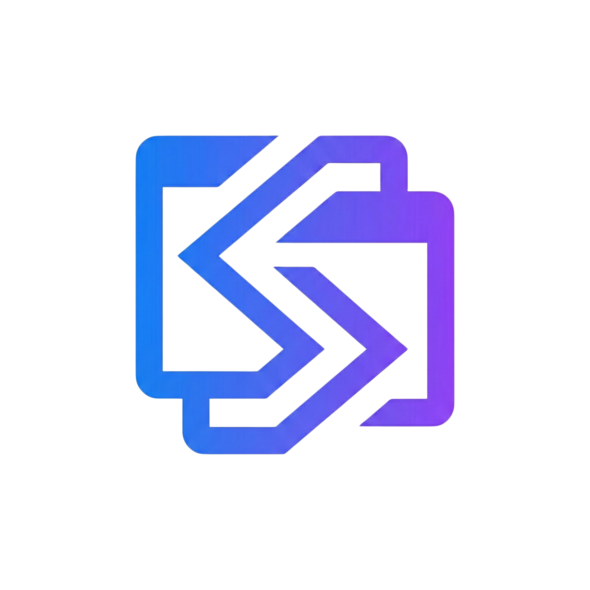
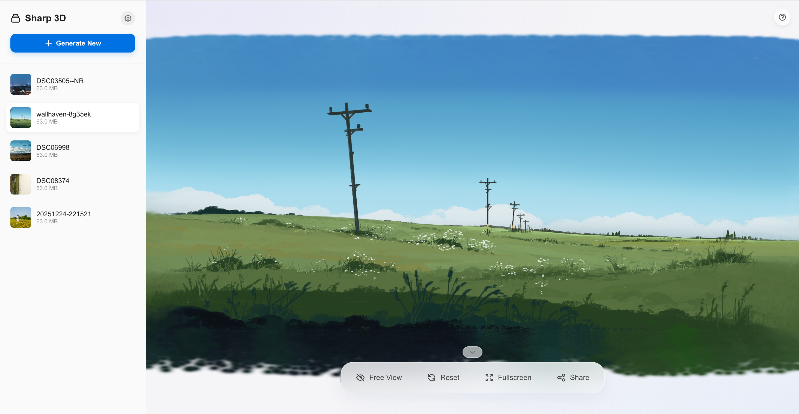
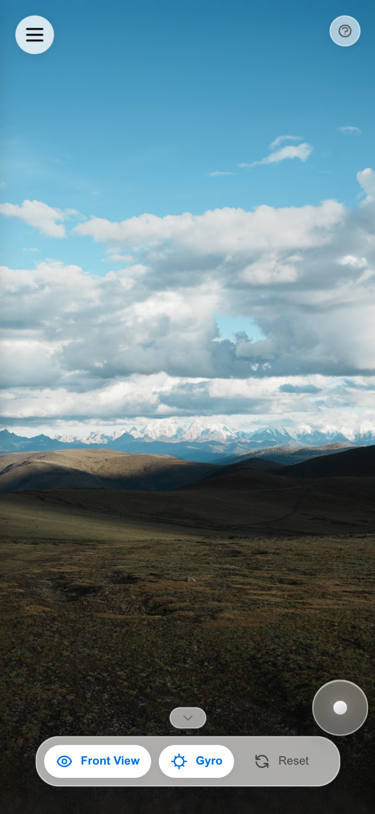
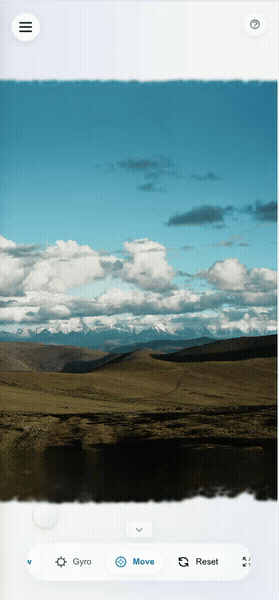
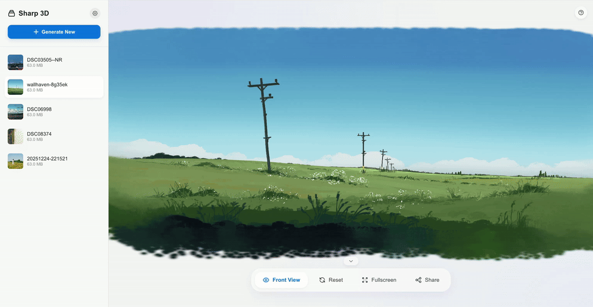

# Sharp GUI

<p align="right">
  <a href="README.md">🇨🇳 中文</a> | <a href="README.en.md">🇺🇸 English</a>
</p>

<div align="center">

**A Beautiful 3D Gaussian Splatting GUI**



<br>

**💡 Background**

Homepage: https://lueluelue12138.github.io/sharp-gui/

The "Spatial Photos" feature in iOS 26 offers an amazing immersive experience, but is currently limited to the Apple ecosystem.

As a Web enthusiast, I built Sharp GUI to bridge this gap. My goal is to let anyone—whether on Android, Windows, Mac or VR device—**[deploy with one click](#-quick-start)** and create and share 3D spatial memories directly via a browser on their local network. This is a hobbyist exploration, built for everyone to enjoy.

<br>


Built on [Apple ml-sharp](https://github.com/apple/ml-sharp). No cloud uploads needed. **Host Locally, Access Everywhere.** Beyond generating and viewing 3D models, Sharp GUI can organize generated results, imported models, and local / external-drive / NAS media into a lightweight model asset library and LAN photo gallery.

[Features](#-features) •
[Preview](#-preview) •
[Quick Start](#-quick-start) •
[Usage](#-usage) •
[LAN Access Gate](#-lan-access-gate-and-privacy-boundary) •
[Architecture](#%EF%B8%8F-architecture)

</div>

> [!WARNING]
> **No content restrictions for local deployment** - Users are fully responsible for generated content. Please comply with local laws and regulations. See [Disclaimer](#-disclaimer).

---

## 📑 Table of Contents

<table align="center">
<tr>
<td width="190" align="center" valign="top">

### 🚀

**Getting Started**

<sub>Up and running in minutes</sub>

<br>

[Recent Highlights](#-recent-highlights)<br>
[Quick Start](#-quick-start)<br>
[Usage Guide](#-usage)<br>
[Version & Updates](#version-and-updates)

</td>
<td width="190" align="center" valign="top">

### ✨

**Features & Design**

<sub>What Sharp GUI can do</sub>

<br>

[Feature Highlights](#-features)<br>
[Interface Preview](#-preview)

</td>
<td width="190" align="center" valign="top">

### ⚙️

**Config & Security**

<sub>Customize and lock down</sub>

<br>

[Configuration](#%EF%B8%8F-configuration)<br>
[Video Reconstruction Settings](#video-reconstruction-settings)<br>
[LAN Access Gate](#-lan-access-gate-and-privacy-boundary)

</td>
<td width="190" align="center" valign="top">

### 🛠️

**Build & Community**

<sub>Hack, ship, and contribute</sub>

<br>

[Architecture](#%EF%B8%8F-architecture)<br>
[Developer Guide](#%EF%B8%8F-developer-guide)<br>
[Release History](#-release-history)<br>
[Contributing](#-contributing) · [Credits](#-acknowledgements)

</td>
</tr>
</table>

<div align="center"><sub>📄 <a href="#-license">License</a> &nbsp;·&nbsp; ⚠️ <a href="#-disclaimer">Disclaimer</a></sub></div>

---

## 🆕 Recent Highlights

<details open>
<summary><b>Click to collapse — user-facing highlights</b></summary>

<br>

**🗂️ Local Media Gallery** — Configure local, external-drive, or NAS folders as albums. Browse, filter, preview, and download photos and videos together; photos can be converted to 3D one by one or in batches, while videos can be played, scrubbed, and viewed fullscreen.

**📦 Model Asset Library** — Browse generated models and imported `.ply/.spz/.splat/.rad` assets together with filters, sorting, cursor-based incremental loading, recent models, a details panel, batch import, download, and delete. The preferred open/download format follows Settings and falls back to available files.

**🎥 Video 3DGS Reconstruction** — Videos use COLMAP + Brush. Includes quality presets, reliable-alignment checks, optional subject cropping, video thumbnails, source replay and `.ply/.spz` export.

**📥 Upload Into Current Album** — Add photos directly to the current album with file picker or drag-and-drop; the album refreshes automatically after upload.

**⚡ Faster Gallery Startup** — Gallery indexing now loads on demand, so startup no longer waits for a full album scan and large libraries show the first screen faster.

**🔐 Safer LAN Access** — Optional access-code gate, real LAN bind toggle, sensitive-file protection, and debug mode off by default make long-running home LAN use safer.

**📦 Windows Full Portable Bundles** — Core bundles `cu128-rtx50` and `cu126-mainstream` ship Python + PyTorch + model cache out of the box, with an additional `cu128-rtx50-video-recon` bundle for RTX 50 video reconstruction (downloaded from the cloud-drive link in the Release notes, with matching `.sha256.txt`).

Full release notes → **[Latest Release](https://github.com/lueluelue12138/sharp-gui/releases/latest)**

</details>

---

## ✨ Features

### 🏠 Host Once, Access Anywhere

No need to install apps on every device. Run Sharp GUI on one computer, and any phone, tablet or VR device on your LAN can access it instantly via browser. Full HTTPS support ensures features like gyroscope work perfectly on all devices.

### 🚀 Core Features

| Feature                    | Description                                                                                                                                                              |
| -------------------------- | ------------------------------------------------------------------------------------------------------------------------------------------------------------------------ |
| **📸 Image to 3D**         | Upload any image; Apple ML-Sharp generates a 3D Gaussian Splatting model. The 2.62 GiB model is pre-downloaded during install.                                          |
| **🎥 Video 3DGS Reconstruction** | Create static Gaussian Splat models from album or dropped videos using COLMAP + Brush, with quality presets, task stages, thumbnails and source replay. |
| **🖼️ Modern Workflow**     | Multi-select / drag-and-drop upload, virtualized gallery, in-app original viewer, smart task queue (2s while active, 10s idle), slide-out delete, cancellable jobs.      |
| **📦 Model Asset Library** | Browse generated and imported models together, with `.ply/.spz/.splat/.rad`, filters, sorting, details metadata, recent models, batch import, and cursor-based incremental loading. |
| **🗂️ Local Media Gallery** | Configure multiple local/NAS folders as albums, browse and filter photos/videos together, preview and download media, convert photos to 3D, play videos, and start video reconstruction. |
| **👁️ Real-time Viewer**    | Three.js + Spark 2.0 WASM-accelerated viewer with mouse / touch / keyboard (WASD) / gyroscope controls, click-to-focus with a GPU focus ring, quick transform panel.     |
| **🎭 Reveal Effects**      | Magic / Spread / Unroll / Twister / Rain entrance animations with replay support.                                                                                        |
| **📱 Mobile Optimized**    | Phones / tablets get gyroscope controls (iOS-style indicator ball), virtual joystick, touch gestures, and a drawer-style sidebar.                                        |
| **🥽 VR/AR Preview**       | WebXR VR mode + AR Passthrough on Quest 3/Pro and similar headsets, with controller / touch input.                                                                       |
| **📤 One-Click Share**     | Export a standalone HTML file powered by Spark 2.0; the compact SPZ payload is embedded by default, double-click to open anywhere.                                       |
| **🎮 GPU Acceleration**    | Auto-detects NVIDIA GPUs and matches a CUDA-enabled PyTorch (cu118 / cu126 / cu128) for noticeably faster inference.                                                     |
| **🔄 Safe Self-Update**    | Settings shows the release and exact commit, with Stable / Latest checks and compatible one-click code updates; failures restore automatically and portable bundles need no system Git. |
| **🔐 Security & Privacy**  | Fully local data, one-click self-signed SSL, optional LAN access gate (HttpOnly cookie + access code + brute-force backoff).                                             |
| **🚀 One-Click Deploy**    | Auto-configures Python / Git, installs deps, pre-downloads models, generates HTTPS certs, and shows skeleton progress. Ready out of the box.                             |

### 🎨 Apple-Style UI Design

Built with Apple Human Interface Guidelines for a premium feel:

| Element                  | Description                                                                                              |
| ------------------------ | -------------------------------------------------------------------------------------------------------- |
| **🪟 Glass Morphism**    | Global `backdrop-filter: blur(30px)` with translucent panels across control bar, toolbar, and modals     |
| **🔤 SF Pro Fonts**      | Apple system font stack for native rendering                                                             |
| **✨ Particle Background** | Canvas floating particles with a soft default fade-in, no harsh first-frame                            |
| **🎬 Smooth Animations** | All interactions tuned with `cubic-bezier` easing; respects `prefers-reduced-motion`                     |
| **🌗 Dark Mode**         | Adaptive system dark mode support                                                                        |
| **🎯 Polished Details**  | Collapsible bottom controls, forward-only progress bar, gradient skeleton loading, slide-out delete, multi-select floating action bar |

### 🔧 Advanced Features

- **🔒 HTTPS Support** - Auto-generated self-signed certificates for safer LAN access (browsers require secure context for sensor APIs)
- **📦 File Optimization** - Auto-generates compact SPZ models, usually **5-10x smaller** than PLY while preserving the original PLY
- **🧹 Auto Cleanup** - Completed tasks auto-removed from memory after 1 hour to prevent leaks
- **⚙️ Configurable Paths** - Custom workspace folder, supports Windows / Linux / macOS
- **🖥️ Fullscreen Mode** - Immersive 3D preview
- **🥽 WebXR** - VR preview + AR Passthrough on Quest 3/Pro and similar headsets
- **🎯 Click-to-Focus** - WASM-accelerated raycasting + GPU focus ring animation
- **🌐 i18n** - Chinese/English bilingual UI, auto-detects browser language, manual toggle

---

## 📷 Preview

### Main Interface

<p align="center">
  
</p>

<p align="center"><i>Model asset library / recent models + 3D model preview + glassmorphism control bar</i></p>

### Local Media Gallery

<p align="center">
  
</p>

<p align="center"><i>Multi-folder albums, mixed photo/video browsing, media preview, multi-select to 3D</i></p>

### Video 3DGS Reconstruction

<p align="center">
  
</p>

<p align="center"><i>Open the reconstruction dialog from an album video or dropped video, then choose mode, quality, custom parameters, and dependency status</i></p>

<p align="center">
  
</p>

<p align="center"><i>Choose a video → configure settings → watch task progress / live preview → open the model result and source-video replay</i></p>

### Mobile Adaptation

<p align="center">
  &nbsp;&nbsp;&nbsp;&nbsp;
  
</p>

<p align="center">
  <i>Left: Mobile drawer sidebar | Right: Tablet split layout</i>
</p>

### 🎬 Camera Movement Controls

<p align="center">
  &nbsp;&nbsp;&nbsp;&nbsp;
  
</p>

<p align="center">
  <i>Left: WASD/QE keyboard movement (Shift for precision) | Right: Mobile virtual joystick</i>
</p>

### 🎬 Batch Upload + Queue Processing

<p align="center">
  
</p>

<p align="center"><i>Drag multiple images to sidebar, queue updates in real-time</i></p>

### 🎬 Gyroscope Control (Mobile)

<p align="center">
  
</p>

<p align="center"><i>Tilt phone to control view, iOS-style real-time indicator ball</i></p>

### 🎬 One-Click Export & Share

<p align="center">
  
</p>

<p align="center"><i>Click Share to export standalone HTML, double-click to open in any browser</i></p>

---

## 🚀 Quick Start

### System Requirements

| Platform                    | Inference Backend | Status        |
| --------------------------- | ----------------- | ------------- |
| **macOS Apple Silicon**     | ✅ MPS            | ✅ Verified   |
| **Windows x86_64**          | ✅ CPU            | ✅ Verified   |
| **Windows x86_64 + NVIDIA** | ✅ CUDA           | ✅ Verified   |
| **Linux x86_64**            | ✅ CPU            | ✅ Verified   |
| **Linux x86_64 + NVIDIA**   | ✅ CUDA           | ❓ Unverified |
| **macOS Intel**             | ✅ CPU            | ❓ Unverified |

> 🎥 **Current video reconstruction platform**: Video 3DGS reconstruction has currently only been verified end-to-end on **Windows + NVIDIA RTX 5070 Ti Laptop GPU (12GB VRAM)**. Other Windows NVIDIA GPUs may work, but Linux, macOS, CPU, and MPS video reconstruction are not yet verified.
>
> 🚀 **NVIDIA GPU recommended**: 3D Gaussian Splatting inference is compute-heavy. CUDA typically delivers **multiple-x to ~10x** speedups over pure CPU, with a noticeably better experience.
>
> 💡 **CPU-only still works**: inference runs fine without a GPU, just slower per image. Apple Silicon users get a near-GPU experience via the MPS backend.
>
> 🛠️ **Zero manual setup**: when an NVIDIA GPU is present, the install script detects your driver and installs the matching CUDA-enabled PyTorch (cu118 / cu126 / cu128).
>
> 🎥 **Video reconstruction environment requires a separate check**: the regular install flow and core portable bundles get the core app and image-to-3D inference running first. To generate 3D models from video, download the `cu128-rtx50-video-recon` bundle, or follow [Video Reconstruction Manual Environment Setup](#video-reconstruction-manual-environment-setup) to install the pinned Brush CLI, COLMAP and `ffmpeg/ffprobe`.
>
> 👉 Unverified platforms should theoretically work. Report issues on [GitHub Issues](https://github.com/lueluelue12138/sharp-gui/issues).

### Option 1: Windows Full Portable Bundle (Recommended for NVIDIA Users)

Windows RTX 50 / mainstream NVIDIA users can use the full portable bundle directly, without manually setting up Python, PyTorch, or the model cache. Pick the dedicated video reconstruction bundle when you need local video 3DGS reconstruction.

Permanent cloud-drive folder: [Open download folder](https://pan.quark.cn/s/94f4acaada40)

The same folder is kept up to date with the latest version. Pick the package for your GPU and use case:

- **RTX 50 series (core features)**: download the `cu128-rtx50` bundle
- **RTX 50 series (video 3DGS reconstruction)**: download the `cu128-rtx50-video-recon` bundle
- **Mainstream NVIDIA below RTX 50 (core features)**: download the `cu126-mainstream` bundle

Download the ZIP and matching `.sha256.txt`, verify SHA256 first, then extract and double-click `portable-run.bat`.

> 💡 Full portable bundles currently target NVIDIA GPUs only; there is no CPU-only portable bundle. The video reconstruction bundle currently targets the RTX 50 / CUDA 12.8 route and does not mean every NVIDIA GPU has been verified.
>
> 🔄 **Self-update bootstrap boundary**: the next full portable release containing the new updater is the first bootstrap bundle. Portable bundles at `v1.3.0` or earlier have neither a managed Git worktree nor bundled MinGit, so they require one final full-package download. Compatible code hotfixes can be applied incrementally after moving to the bootstrap bundle.

### Option 2: Install from Source (Recommended for macOS / Linux / Developers)

The source repo already includes the latest built frontend assets. For normal use, you do not need Node.js or a manual frontend build; run the install script to set up Python, then start the app.

```bash
# 1. Clone project
git clone https://github.com/lueluelue12138/sharp-gui.git
cd sharp-gui

# 2. Run install script (auto-clones ml-sharp and configures environment)
./install.sh      # Linux/macOS
# or
install.bat       # Windows

# 3. Start server
./run.sh          # Linux/macOS
# or
run.bat           # Windows
```

> 💡 Install Node.js and run `./build.sh` / `build.bat` only if you modify the frontend source and need to regenerate `frontend/dist/`.
>
> 💡 The install script auto-generates HTTPS certificates. HTTPS mode is recommended for full functionality.
>
> 🎥 If you need video reconstruction, finish the regular install first, then prepare the separate dependencies in [Video Reconstruction Manual Environment Setup](#video-reconstruction-manual-environment-setup).

### Option 3: Generic Release Package (No git clone)

The GitHub Release ZIP is a source snapshot with the built frontend already included. It is useful if you do not want to use `git clone`; functionally it is close to source install and still needs the install script to configure Python, dependencies, and models.

Download the latest version from [Releases](https://github.com/lueluelue12138/sharp-gui/releases):

```bash
# 1. Download and extract
unzip sharp-gui-vX.Y.Z.zip
cd sharp-gui

# 2. Run install script
./install.sh      # Linux/macOS
# or
install.bat       # Windows

# 3. Start server
./run.sh          # Linux/macOS
# or
run.bat           # Windows
```

> 💡 Want latest features? Download [Pre-release](https://github.com/lueluelue12138/sharp-gui/releases) versions (marked as `Pre-release`).
>
> 🎥 The regular Release ZIP flow covers the core app environment first; confirm video reconstruction dependencies separately via [Video Reconstruction Manual Environment Setup](#video-reconstruction-manual-environment-setup).

### What Does the Install Script Do?

The install script automatically handles all setup steps, no manual configuration needed:

- 🐍 **Detect/Install Python** - Auto-finds compatible version (3.10~3.13), auto-installs if missing (Windows)
- 📦 **Detect/Install Git** - Auto-installs if missing (Windows)
- 🎮 **Detect NVIDIA GPU** - Auto-installs the CUDA-enabled PyTorch that matches your driver (cu118 / cu126 / cu128)
- 🧩 **Install Dependencies** - Creates virtual environment, installs ml-sharp core and GUI deps
- 🎥 **Video reconstruction environment is prepared separately** - Brush CLI, COLMAP, and `ffmpeg/ffprobe` are not required for the regular install; follow [Video Reconstruction Manual Environment Setup](#video-reconstruction-manual-environment-setup) when you need video reconstruction
- 📥 **Pre-download Model** - Downloads the approximately 2.62 GiB inference model during install, avoiding a first-run wait
- 🔐 **Generate HTTPS Certificate** - Auto-generates self-signed certificate for secure LAN access

### Start Server

```bash
./run.sh          # Linux/macOS (React version)
./run.sh --legacy # Use original single-file version
# or
run.bat           # Windows
```

Access **https://127.0.0.1:5050 (recommended)** or **http://127.0.0.1:5050** 🎉

> 🩺 When reporting an issue, run in verbose mode: `./run_verbose.sh` / `run_verbose.bat`. It captures runtime info, command paths, PATH, and full exception traces into `sharp-gui-verbose.log`.

### Version and Updates

Open **Application Update** at the bottom of **Settings** to see the current version, choose a channel, check, and install. The app restarts automatically and restores the previous version if verification fails.

- **Stable (recommended)**: the highest formal `vX.Y.Z` tag in the repository.
- **Latest**: the newest commit on `main`. It receives hotfixes sooner but is less tested than Stable.

Portable bundles use their bundled Python and Git; clean source installations on `main` are supported too. Code updates preserve workspaces, models, configuration, and large Python/CUDA runtimes. If a target needs a different runtime, the app asks for a new complete bundle. Portable bundles at `v1.3.0` or earlier must first move to a complete bundle containing the new updater.

Use Settings if you do not need the command line. The scripts provide equivalent operations:

```bash
# Linux / macOS
./update.sh --channel stable --check
./update.sh --channel stable
```

```bat
:: Windows
update.bat --channel stable --check
update.bat --channel stable
```

Replace `stable` with `latest` to check or install Latest. Developers on another branch or with local code changes should keep using the normal Git workflow.

Developer and maintainer details are available in the Chinese guide: [Self-update development rules](.agents/rules/self-update.md).

### Uninstall

Core app dependencies are installed inside the project's `venv/` virtual environment; if video reconstruction is enabled, its separate dependencies live in `.sharp-gui-tools/`. They do not affect your system environment. To uninstall, simply delete the project folder:

```bash
# Delete project (includes venv, .sharp-gui-tools, ml-sharp, models, etc.)
rm -rf sharp-gui/

# (Optional) Clean model cache
# Windows: del %USERPROFILE%\.cache\torch\hub\checkpoints\sharp_*.pt
# macOS/Linux: rm ~/.cache/torch/hub/checkpoints/sharp_*.pt
```

---

## 📖 Usage

### Generate 3D Models

1. **Upload Image** - Click "Generate New" or drag images to sidebar
2. **Wait for Processing** - Watch the queue stages (if installation did not finish the download, first inference downloads the approximately 2.62 GiB model)
3. **Preview Model** - Click gallery items to view 3D

### Manage the Model Asset Library

1. **Browse assets** - Generated results and imported models appear in one asset library. The main grid uses cursor-based incremental scroll loading, not a paginator or per-page selector.
2. **Open and inspect** - Click the non-button area of a model card to open the viewer. On desktop, the hover details button opens the right details panel; on mobile, tapping a card opens the details card.
3. **Import models** - Use "Import Model" or drop `.ply/.spz/.splat/.rad` files. Dropping one model opens a temporary preview first; dropping multiple models imports them into the asset library.
4. **Format preference** - Settings > Default Model Format controls whether SPZ or PLY is preferred for recent models, asset opening, and downloads. If the preferred file is unavailable, Sharp GUI falls back to an available model file.
5. **Details metadata** - File name, format, source, timestamps, and size come from the index and filesystem. PLY/SPLAT can expose some point count or property data; SPZ/RAD bounding boxes, coordinate systems, LoD, and similar advanced fields only appear when the source file or sidecar metadata provides them, so unknown fields are not fabricated.
6. **View source media** - The details-panel thumbnail opens the linked source image or video when one exists. Without a linked source, it only acts as the model cover.

### Browse Local Media Albums

1. **Switch to Gallery** - Use the sidebar `Models / Photos` entry to open the local media gallery
2. **Add Folder** - From localhost, add Windows / Linux / macOS paths; each folder is shown as an album
3. **Browse Media** - Photos use cached thumbnails and open originals on demand; videos can be previewed, scrubbed, viewed fullscreen, and downloaded
4. **Upload to Album** - Pick or drag photos into the current album; the album refreshes automatically
5. **Convert to 3D** - Convert photos from cards or the preview layer, or multi-select and queue a batch into the existing workflow

### Generate 3D Models from Video

Check dependencies in Settings > Video Reconstruction. **Brush** trains the model with COLMAP camera alignment. See [Video Reconstruction Manual Environment Setup](#video-reconstruction-manual-environment-setup).

1. **Select a video** - Choose one album video or drop one video into the model view, model list or Generate New entry.
2. **Choose quality** - Brush custom settings expose frame count, iterations, an actual long-edge pixel cap and matching method.
3. **Reconstruct** - After extraction and alignment, training requires at least 8 registered frames and a 50% registration rate. Poor alignment triggers one retry with denser sampling or broader matching; if it still fails, recapture or split the clip. Before Brush training, images and camera intrinsics are undistorted together, and camera poses and sparse points are rotated to share a consistent up direction.
4. **View the result** - Open the gallery model, replay the source, or download PLY/SPZ. New SPZ exports retain higher-order spherical harmonics; old SH0 files require conversion from their original PLY to restore those coefficients.

Brush presets:

| Preset | Iterations | Image long-edge cap |
| --- | ---: | --- |
| Preview | 8,000 | 1600 pixels |
| High | 15,000 | 1920 pixels |
| Extreme | 30,000 | Adjusted to VRAM budget |
| Custom | 1,000–80,000 | 640–3840 pixels |

Preview, High and Extreme initially sample about 6 / 8 / 12 frames per second, with 1200 / 1600 / 3200 pixel camera registration caps and 4096 / 8192 / 16384 feature budgets. These correspond to OOOSplat's Fast, Balanced and High recipes. High retains a 1920 pixel training cap; Extreme retains 3840 pixels with a 12 GB budget. Denser candidate pools use about 9 / 12 / 15 frames per second and preserve the initial list. Unknown source frame counts fall back to time sampling. See the [quality validation record](docs/video-reconstruction-quality.md) for the same-video comparison and its limits.

- **Long videos**: start with Custom at 600 frames / 15k / 1920 pixels / sequential matching. More frames increase geometry and training cost. Exhaustive matching is limited to 450 frames.
- **Modes**: Auto and Environment keep the full reconstruction. Only Object crops around the subject, which may remove surrounding geometry; automatic foreground masks are not provided.
- **VRAM**: choose the actual GPU capacity. The target laptop has 12 GB, so a 16 GB budget is inappropriate.
- **Diagnostics**: a compact report remains in the model sidecar. Keep intermediate files to inspect frames, poses and training files, including the original PLY before object cropping.
- **Initial view**: new Brush models preserve a registered camera viewpoint, keeping the subject visible when distant splats pull the bounding-box center away.
- **Validation scope**: synthetic workflow tests and a complete local reconstruction of a nonsensitive video have passed, including PLY renders and SPZ viewer validation. Quality depends on the footage. Runtime depends on camera alignment and scene size, and extra iterations cannot recover missing views.
- **Scope**: one video per static 3DGS task. Joint multi-image reconstruction has not been integrated.

### 3D Interaction Controls

#### Basic Operations

| Action      | Desktop          | Mobile              |
| ----------- | ---------------- | ------------------- |
| Rotate View | Left-click drag  | Single finger swipe |
| Pan         | Right-click drag | Two finger pan      |
| Zoom        | Scroll wheel     | Pinch               |
| Fine Zoom   | Shift + Scroll   | -                   |
| Lock Focus  | Click on model   | Tap on model        |

#### Camera Movement

| Control              | Description                                           |
| -------------------- | ----------------------------------------------------- |
| **WASD / QE**        | Keyboard camera pan (forward/back/left/right/up/down) |
| **Shift + WASD**     | Fast movement mode                                    |
| **Alt + WASD**       | Precision movement mode                               |
| **Virtual Joystick** | Mobile touch pan (tap Move button to enable)          |

#### Special Modes

| Mode           | Action                          | Description                                                                |
| -------------- | ------------------------------- | -------------------------------------------------------------------------- |
| Quick Controls | Tap the gear button             | Adjust model scale, position, rotation, interaction direction, and quality |
| Reveal Effects | Use the right-side effects rail | Switch or replay Magic / Spread / Unroll / Twister / Rain                  |
| Gyroscope      | Tap "Gyro" button               | Tilt phone to control view                                                 |
| Front View     | Tap "Front View" button         | Lock to front view, tap again free                                         |
| Reset          | Tap "Reset" button              | Restore initial view                                                       |
| Fullscreen     | Tap "Fullscreen" button         | Immersive preview                                                          |
| VR Preview     | Tap "VR" button                 | Enter VR mode (requires VR device)                                         |
| AR Preview     | Tap "AR" button                 | AR Passthrough overlay 3D model                                            |
| Reset          | Press "R" key                   | Quick reset camera to initial view                                         |

### Export & Share

Click **Share** button to generate a standalone HTML file:

- 📦 Complete 3D viewer included (Three.js + Spark 2.0)
- 🌐 No server needed, double-click to open in browser
- 📉 Embeds compact SPZ by default; the legacy PLY/Splat export path remains available for compatibility
- 🔒 Includes disclaimer about content responsibility

---

## ⚙️ Configuration

### Custom Workspace

Configure via UI settings or edit `config.json` (generated on first run):

```json
{
  "workspace_folder": "/path/to/workspace",
  "photo_gallery_roots_by_workspace": {
    "/path/to/workspace": [
      {
        "id": "my-album",
        "name": "Photos",
        "path": "/path/to/photos",
        "recursive": true,
        "enabled": true
      }
    ]
  }
}
```

The system auto-creates:

- `inputs/` - Uploaded images; `inputs/.thumbnails/` stores legacy/model thumbnail cache
- `outputs/` - Generated models and sidecar metadata (`.ply` / `.spz` / `.meta.json`)
- `model-assets/` - Controlled model asset file area: `imports/` stores imported models, `thumbnails/` stores cached covers
- `.model-asset-library/` - Model asset index and user-edited metadata (`index.json`)
- `.photo-gallery-cache/` - Local media gallery cache: `catalog.json`, `albums/`, `thumbnails/`, `video-posters/`, and temporary ZIP packages
- `.video-reconstruction/` - Video reconstruction runtime data: `jobs/` and `uploads/`

These workspace runtime folders are user data and are ignored by `.gitignore` by default; they should not be committed. After changing the workspace in Settings and letting the app restart, `inputs/`, `outputs/`, `model-assets/`, `.model-asset-library/`, `.photo-gallery-cache/`, and `.video-reconstruction/` all switch to the new workspace. Switching back to an old workspace restores that workspace's model assets, recent-model index, gallery cache, and task-related state.

Project-root `config.json`, `cert.pem` / `key.pem`, `sharp-gui-verbose.log`, `venv/`, `.sharp-gui-tools/`, and `ml-sharp/` are deployment config, certificates, logs, or dependency folders. They do not switch with the workspace; sensitive files are never exposed through `/files/*`.

> 💡 Albums can be added from the UI and are remembered per workspace: `photo_gallery_roots_by_workspace` is keyed by the normalized workspace path, so switching workspaces shows each one's own albums and switching back restores them. When editing manually, use paths from the server machine. Windows, Linux, and macOS are supported; LAN clients browse folders on the host running Sharp GUI.
>
> ⚠️ Older versions stored albums in a top-level `photo_gallery_roots` array. On the first launch after upgrading, it is automatically migrated into the bucket for the current workspace — no manual action needed.

### Video Reconstruction Configuration

Settings stores default quality, actual VRAM budget and the intermediate-file preference. Videos use **Brush + COLMAP + ffmpeg/ffprobe**. Saved engine preferences migrate to Brush.

Diagnostics expose `required` (decoding) and `brush` (COLMAP and Brush). Startup warms the cache asynchronously; Refresh requests a new scan. Missing Brush does not trigger another trainer.

The preferred model format controls previews and downloads: SPZ is compact, while PLY preserves original data. Missing formats fall back to available assets.

### Video Reconstruction Manual Environment Setup

The route is **ffmpeg/ffprobe → native COLMAP → official Brush CLI v0.3.0**. RTX 50 users can download the complete `cu128-rtx50-video-recon` bundle; core bundles do not include video tools. Video tools do not require a separate Python training environment or CUDA Toolkit.

#### 1. Install video tools

After installing the core app, run in the Windows project root:

```powershell
.\venv\Scripts\python.exe tools/install_video_reconstruction.py
```

The installer places native COLMAP in `.sharp-gui-tools/colmap/` and the hash-verified official [Brush v0.3.0](https://github.com/ArthurBrussee/brush/releases/tag/v0.3.0) in `.sharp-gui-tools/brush/v0.3.0/`. Existing installations migrate only native COLMAP programs and DLLs. FFmpeg and ffprobe are supplied by `install.bat` or the complete video bundle.

On Linux/macOS, install COLMAP and FFmpeg using your package manager, then run `python tools/install_brush.py`. A compatible GPU driver is needed. Use the Brush CLI, rather than merely opening its editor.

#### 2. Check the environment

Open Settings > Video Reconstruction and refresh, or request:

```powershell
curl.exe http://127.0.0.1:5050/api/video-reconstructions/status
```

| Group | Purpose |
| --- | --- |
| `required` | ffmpeg / ffprobe decoding |
| `brush` | Native COLMAP + pinned Brush CLI |

`summary.brush_available` reports complete-route readiness. High quality retains a 1920 long-edge cap / 15,000 iterations; Extreme retains 3840 / 30,000 on a 12 GB budget. Smaller inputs are never enlarged.

Intermediate files live in the workspace's `.video-reconstruction/jobs/`; PLY, SPZ and reports live in `outputs/`. Disabling intermediate retention removes the task folder while retaining models and reports. The legacy video environment is no longer used, but updates still protect old installation directories and existing models.

### Enable HTTPS (Recommended)

HTTPS enables **gyroscope on LAN devices** (browsers require secure context for sensor APIs).

The install script auto-generates certificates. For manual generation:

```bash
python tools/generate_cert.py
```

> 💡 **Windows Users**: Install [Git for Windows](https://git-scm.com/download/win) or OpenSSL first.

After generating, restart and access via `https://`:

| Mode      | Local                  | LAN               | Gyroscope     |
| --------- | ---------------------- | ----------------- | ------------- |
| **HTTPS** | https://127.0.0.1:5050 | https://[IP]:5050 | ✅ Available  |
| HTTP      | http://127.0.0.1:5050  | http://[IP]:5050  | ❌ Local only |

First HTTPS access shows certificate warning (self-signed), click "Continue" to proceed.

---

## 🔐 LAN Access Gate and Privacy Boundary

Sharp GUI ships an **optional** LAN access gate. On first startup—or whenever the local owner has not finished configuring it—the app shows a gentle reminder to set an access code; you can configure it later or stop showing the reminder. The gate is off by default; existing `config.json` files keep working unchanged.

### Permission Matrix

The table below shows the permission boundaries for each role:

| Action                                   | Public (locked remote) | Unlocked Remote (with access code) | Local Owner (localhost) |
| ---------------------------------------- | :--------------------: | :--------------------------------: | :---------------------: |
| Browse models / photos / thumbnails      | ❌ (when gate is on)   |                 ✅                 |           ✅            |
| Download originals / model files / HTML  | ❌ (when gate is on)   |                 ✅                 |           ✅            |
| Submit generation / photo-to-3D jobs     |          ❌            |  Only when "Remote Generation" is on |          ✅            |
| Modify settings / delete model / restart |          ❌            |                 ❌                 |           ✅            |
| Manage album folders / cancel tasks      |          ❌            |                 ❌                 |           ✅            |

### Key Behaviours

- **When the gate is on**, model lists, thumbnails, originals, photo albums, downloads, exports, and `/files/*` workspace resources require LAN devices to enter the access code first; after a successful unlock, the browser keeps an HttpOnly Cookie session.
- **When the gate is off**, devices on the same LAN that can reach the port may browse and download private content directly; deletion, settings, restart, folder management and other owner-only actions still require `localhost` / `127.0.0.1`.
- **Remote generation is off by default**: even with a valid access code, remote devices only get browse / preview / download / export permissions. To allow unlocked remote devices to submit generation jobs, enable Remote Generation in Settings > LAN Access Control; turning the gate off also revokes remote generation permission.
- **Brute-force resistance**: failed logins back off per client, and the server validates the host allowlist plus real connection address — `X-Forwarded-For` and similar headers can never escalate to owner.
- **HTTPS vs gate**: HTTPS protects transport and browser sensor capabilities; the access code protects authorization. Enable both when sharing the port on your LAN.

### Privacy & Deployment Notes

- **Sensitive files stay private**: `/files/*` serves only `outputs/` models, legacy thumbnails, `model-assets/imports/` imported models, and `model-assets/thumbnails/` cover caches. `config.json` (session secret and access-code hash), `.model-asset-library/index.json`, `cert.pem`/`key.pem` (TLS private key), and `app.py` source **can never** be downloaded through that route, whether the gate is on or off.
- **LAN bind toggle is real**: Settings > LAN Access Control lets you switch the listening bind. On listens on `0.0.0.0` (LAN sharing); off listens on `127.0.0.1` only (localhost-only, other devices cannot connect). A restart is required after changing it; `SHARP_BIND_HOST` can override.
- **Debug mode off by default**: the server runs without the framework debugger, so errors never leak stack traces and no interactive debugger is exposed. Set `SHARP_DEBUG=1` only for local troubleshooting, never when sharing on a LAN or the internet.
- **Reverse proxy caveat**: this service is designed to run directly on the local machine and normally needs no reverse proxy. If you do front it with a local proxy (nginx / frp, etc.), every request appears to come from `127.0.0.1`, so **every visitor is treated as owner**. To force the access code behind a proxy, set an access code first, then manually change `access_control.allow_localhost_bypass` to `false` in `config.json` (there is no Settings toggle for it). **Note: disabling the localhost bypass also drops local owner status, so self-update (checking / installing updates) becomes unavailable**; update via the `update.bat` / `update.sh` command line or a fresh complete package instead. The project never trusts spoofable forwarding headers such as `X-Forwarded-For`.
- **Public exposure warning**: this service is designed for LAN use. Before port-forwarding to the internet, enable the gate, set a strong access code, turn on HTTPS, and assess the risk yourself.

---

## 🏗️ Architecture

### Project Structure

```
sharp-gui/
├── 📄 app.py                 # Flask compatibility entry (exports app, runs server)
├── 📁 backend/               # Modular Flask backend
│   ├── 📄 app_factory.py     # create_app(): registers hooks/routes and TaskManager
│   ├── 📄 server.py          # Server startup, HTTPS/LAN bind, restart support
│   ├── 📄 runtime.py         # Env vars, verbose logging, Sharp command/device resolution
│   ├── 📄 config.py          # config.json and access-control normalization
│   ├── 📄 paths.py           # workspace/inputs/outputs/cache path context
│   ├── 📁 security/          # LAN access gate, permission matrix, request hooks
│   ├── 📁 services/          # Model asset/photo gallery, video reconstruction, task queue, self-update, export, static-file services
│   └── 📁 routes/            # auth/gallery/model_assets/photo_gallery/video_reconstruction/tasks/settings/updates/files/export/frontend
├── 📄 install.sh/bat         # One-click install scripts
├── 📄 run.sh/bat             # Startup scripts (supports --legacy flag)
├── 📄 run_verbose.sh/bat     # Verbose entry (writes sharp-gui-verbose.log)
├── 📄 build.sh/bat           # Frontend build scripts
├── 📄 update.sh/bat          # Auto-update scripts
├── 📄 update-manifest.json   # Update protocol, portable runtime revision, and target compatibility contract
├── 📄 release.sh/bat         # Release packaging scripts
├── 📁 .sharp-gui-update/     # Local update state, operation lock, and diagnostics (created at runtime)
├── 📁 .sharp-gui-tools/      # Portable package tools, including verified MinGit
├── 📁 tools/                 # Utility scripts
│   ├── 📄 generate_cert.py   # SSL certificate generator
│   ├── 📄 download_model.py  # Model downloader
│   ├── 📄 detect_cuda.py     # CUDA version detection
│   ├── 📄 install_torch.py   # Smart PyTorch + CUDA installer / verifier
│   └── 📄 update.py          # Auto-update core logic
├── 📁 frontend/              # React modern frontend (v1.0.0+)
├── 📁 templates/             # Original single-file frontend (Legacy)
├── 📁 static/lib/            # Three.js + Gaussian Splats 3D (legacy frontend)
├── 📁 ml-sharp/              # (after install) Apple ML-Sharp core
├── 📁 inputs/                # Input images
├── 📁 outputs/               # Output models (.ply + .spz)
├── 📁 model-assets/          # Imported models and asset cover cache (inside workspace by default)
├── 📁 .model-asset-library/  # Model asset index and user-edited metadata (inside workspace by default)
├── 📁 .video-reconstruction/ # Video reconstruction jobs, uploaded video cache, and intermediates (inside workspace by default)
└── 📁 .photo-gallery-cache/  # Photo gallery index and thumbnail cache (inside workspace by default)
```

### Frontend Architecture (React)

```
frontend/
├── 📁 src/
│   ├── 📁 api/               # API client (gallery, modelAssets, photoGallery, tasks, settings, auth)
│   ├── 📁 components/
│   │   ├── 📁 common/        # Common components (Button, Modal, Loading, ImageViewer, ParticleBackground)
│   │   ├── 📁 gallery/       # Gallery components (GalleryList, GalleryItem)
│   │   ├── 📁 modelAssets/   # Model asset library components (LibraryView, Grid, Toolbar, DetailsPanel)
│   │   ├── 📁 photoGallery/  # Local photo gallery components (AlbumList, MasonryGrid, Toolbar)
│   │   ├── 📁 layout/        # Layout components (Sidebar, ControlsBar, TaskQueue, Settings, AccessGate)
│   │   └── 📁 viewer/        # Viewer components (ViewerCanvas, QuickControls, ViewerRevealEffectsRail, VirtualJoystick, GyroIndicator)
│   ├── 📁 hooks/             # Custom Hooks (useViewer, useXR, useGyroscope, useKeyboard, useGalleryVirtualizer)
│   ├── 📁 i18n/              # Internationalization (zh.json, en.json)
│   ├── 📁 store/             # Zustand state management
│   ├── 📁 styles/            # Global styles (variables, animations)
│   ├── 📁 types/             # TypeScript type definitions
│   └── 📁 utils/             # Utility functions
├── 📄 vite.config.ts         # Vite config (code splitting)
└── 📁 dist/                  # Build output
```

### Tech Stack

| Layer            | Technology                                             |
| ---------------- | ------------------------------------------------------ |
| **Frontend**     | React 19 + TypeScript + Vite / Single-file (Legacy)    |
| **State**        | Zustand                                                |
| **i18n**         | i18next + react-i18next                                |
| **Styling**      | CSS Modules + Apple Glass Morphism                     |
| **Backend**      | Python 3.10+, Flask app factory + Blueprints, TaskManager |
| **AI Engine**    | Apple ML-Sharp (PyTorch, gsplat); video reconstruction uses Brush + COLMAP/ffmpeg |
| **3D Rendering** | Three.js + Spark 2.0 (WASM-accelerated Gaussian Splatting) |

### Performance Optimizations

| Optimization              | Description                                                                                                                              |
| ------------------------- | ---------------------------------------------------------------------------------------------------------------------------------------- |
| **Code Splitting**        | Vite manualChunks: three.js (~493KB), spark (~487KB), react-vendor (4KB)                                                                 |
| **Thumbnail System**      | The model asset library reuses source-media thumbnails or cached covers; photo gallery creates cached thumbnails on demand and only loads originals for preview/download |
| **Asset Library Browsing** | The model asset library uses cursor-based incremental scrolling; grid density only changes the displayed columns and does not rescan model folders |
| **Video Reconstruction Cache** | Backend warms and caches video reconstruction dependency status once per process; Settings can refresh it, and video outputs use sidecar metadata in the existing model gallery |
| **Smart Polling**         | Active 2s polling, idle 10s, saves resources                                                                                             |
| **Format Conversion**     | Auto-converts generated models to compact SPZ; share export embeds SPZ by default while preserving the legacy PLY/Splat path             |
| **Memory Cleanup**        | Completed tasks auto-removed from memory after 1 hour                                                                                    |
| **Progress Optimization** | Progress bar only moves forward, no visual jumping                                                                                       |

---

## 🛠️ Developer Guide

### Frontend Development

```bash
# Install dependencies
cd frontend
npm install

# Development mode (hot reload)
npm run dev

# Build for production
npm run build
# Or use project script
./build.sh
```

### Switch Frontend Version

```bash
./run.sh           # Use React modern version (default)
./run.sh --legacy  # Use original single-file version
./run.sh --verbose # Enable detailed diagnostics log (written to sharp-gui-verbose.log)
```

### Environment Variables

The `app.py` compatibility entry and `backend/` modules honor the following environment variables. Regular users don't need to set any; they're handy for development and troubleshooting:

| Variable | Default | Description |
|----------|---------|-------------|
| `SHARP_FRONTEND_MODE` | `react` | Frontend mode: `react` (built) or `legacy` (single-file). `run.sh --legacy` sets it to `legacy`. |
| `SHARP_DEBUG` | off | Set `1`/`true` to enable the Flask debugger (returns stack traces to the browser, enables the interactive debugger). **Security risk — local troubleshooting only, never enable on a LAN/public network.** |
| `SHARP_VERBOSE` | off | Set `1`/`true` for the detailed diagnostics log file. `run.sh --verbose` / `run.bat --verbose` sets it. |
| `SHARP_LOG_LEVEL` | `INFO` (`DEBUG` when verbose) | Application log level. |
| `SHARP_HTTP_LOGS` | off | Set `1`/`true` to print Werkzeug HTTP request logs; off by default to avoid thumbnail/polling request spam. |
| `SHARP_LOG_FILE` | `sharp-gui-verbose.log` | Output path for the detailed diagnostics log. |
| `SHARP_BIND_HOST` | follows the gate setting | Overrides the listen address. When unset it follows the "LAN access" toggle in Settings (on → `0.0.0.0` / off → `127.0.0.1`). |
| `SHARP_LAN_IP` | auto-detected | LAN IP shown in the startup banner; injected automatically by `run.sh`. |
| `SHARP_DEVICE` | auto-selected | Inference device: `cpu` / `cuda` / `mps`; leave empty to auto-detect. |

> `SHARP_DEBUG` controls the debugger, stack trace exposure, and source hot-reload together — all three are off by default. Set to `1` to enable all, for local troubleshooting only. (Hot-reload is coupled to the debugger because the Werkzeug reloader inherits the listening socket in a way that breaks `/api/restart`'s address rebind.)

### Create Release Package

```bash
# Auto build and package
./release.sh v1.0.0

# Output: sharp-gui-v1.0.0.zip (includes pre-built frontend)
```

---

## 🤝 Acknowledgements

- [Apple ML-Sharp](https://github.com/apple/ml-sharp) - Core 3D generation model
- [Spark](https://github.com/nickthetimid/spark) - WASM-accelerated Gaussian Splatting rendering engine (Spark 2.0)
- [Gaussian Splats 3D](https://github.com/mkkellogg/GaussianSplats3D) - Original Three.js Gaussian Splatting renderer (Legacy version)
- [antimatter15/splat](https://github.com/antimatter15/splat) - Splat format conversion reference

---

## 🙋 Contributing

Issues and Pull Requests are welcome!

- 🐛 **Bug Reports** - Submit issues on [GitHub Issues](https://github.com/lueluelue12138/sharp-gui/issues)
- 💡 **Feature Requests** - Discuss new feature ideas via Issues
- 🔧 **Code Contributions** - Fork the project and submit PRs
- 🖥️ **Platform Testing** - If you've tested on NVIDIA GPU or other unverified environments, we'd love your feedback!

---

## 📜 Release History

Full release notes, feature evolution, pre-release channel, and download links:

- 📦 **[GitHub Releases](https://github.com/lueluelue12138/sharp-gui/releases)** — every release with notes
- 🆕 **[Latest](https://github.com/lueluelue12138/sharp-gui/releases/latest)** — current stable release
- 🧪 **[Pre-release Channel](https://github.com/lueluelue12138/sharp-gui/releases?q=prerelease%3Atrue)** — early access to upcoming features

---

## ⚠️ Disclaimer

Since local deployment has **no content restrictions**, 3D models generated by this project are created by users using AI tools. **Users are solely responsible for the generated content**, which is unrelated to this open source project and its developers.

**It is strictly prohibited to use this tool to generate or distribute any illegal, infringing, or inappropriate content.**

---

## 📄 License

This project is open source under the MIT License.

When portable bundles include MinGit or other third-party components, see [THIRD_PARTY_NOTICES.md](THIRD_PARTY_NOTICES.md) for their provenance, versions, and license locations.

Note: the Sharp GUI code's MIT License does not cover the ML-Sharp models. Those models remain under Apple's separate [Model License](https://github.com/apple/ml-sharp/blob/main/LICENSE_MODEL), for non-commercial use only.

---

<div align="center">

**If you find this useful, please give a ⭐ Star!**

Made with ❤️ by [lueluelue12138](https://github.com/lueluelue12138)

</div>
