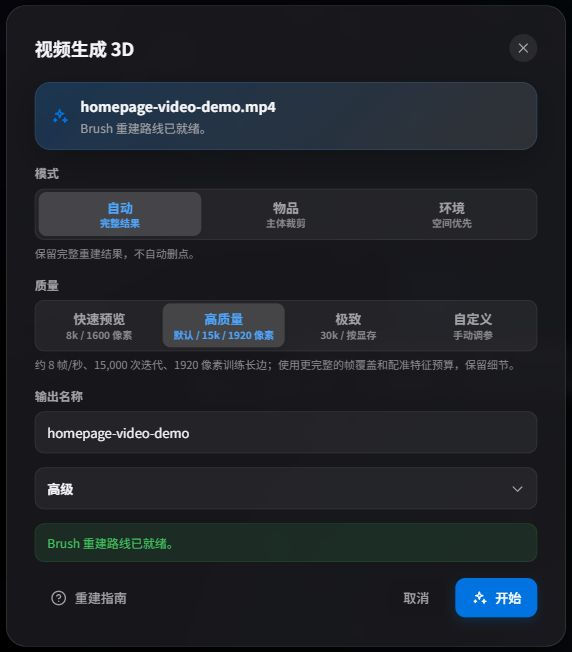
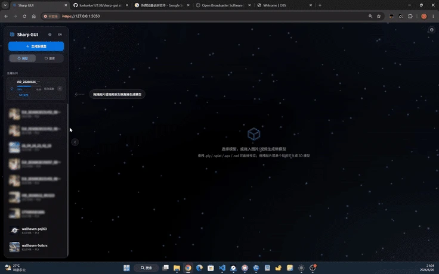
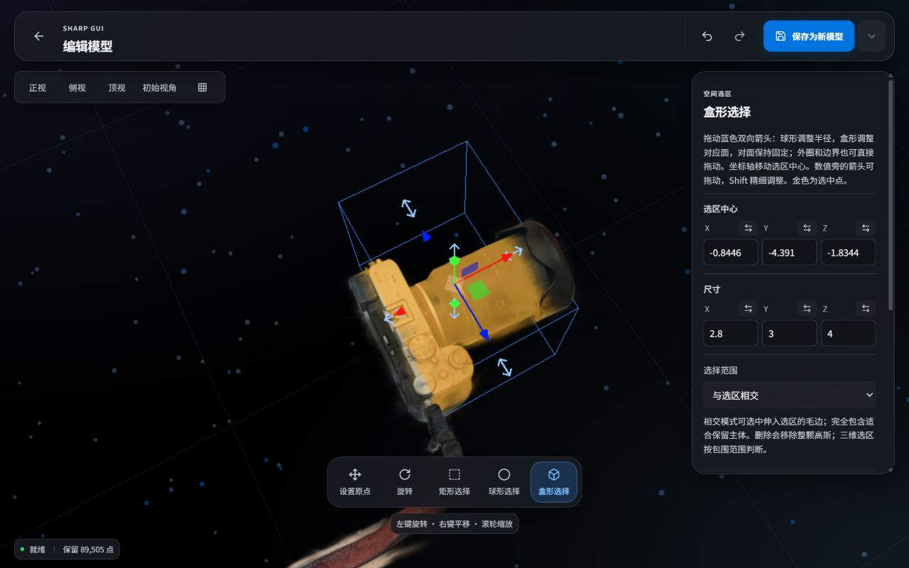
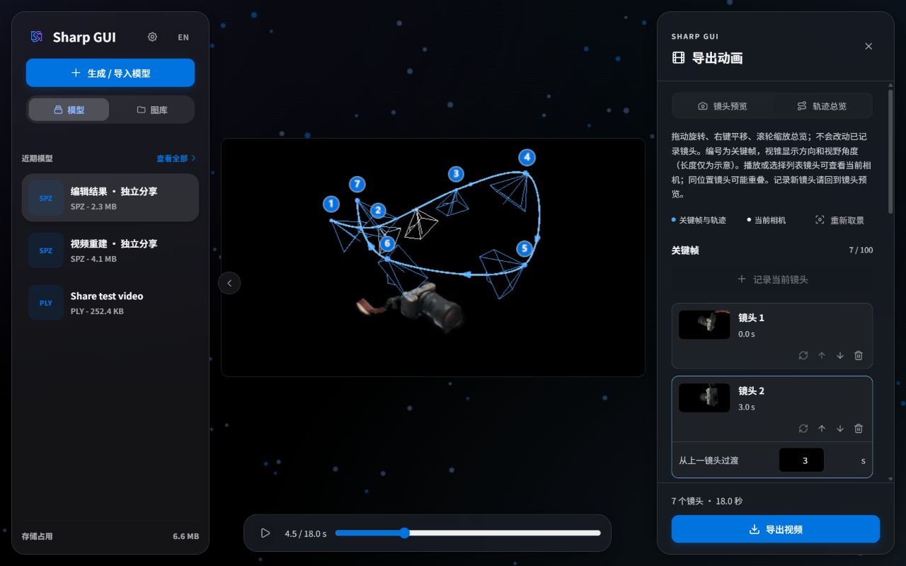
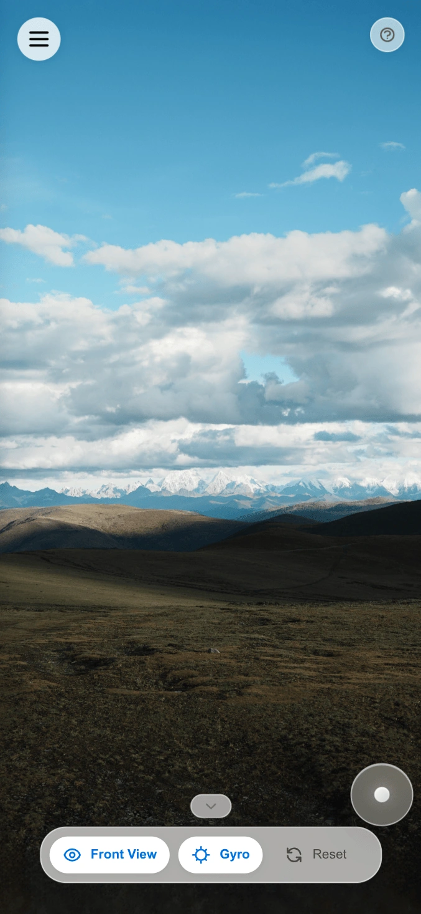
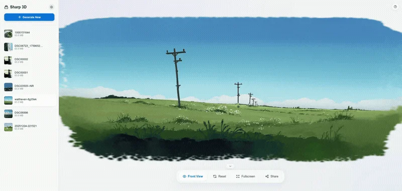
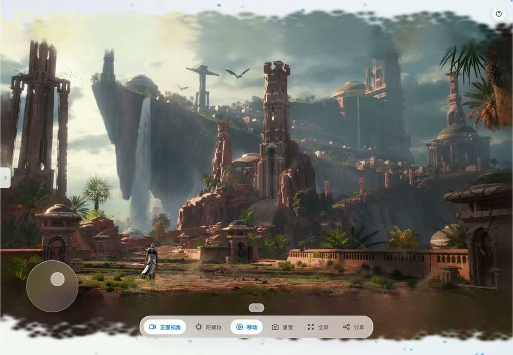
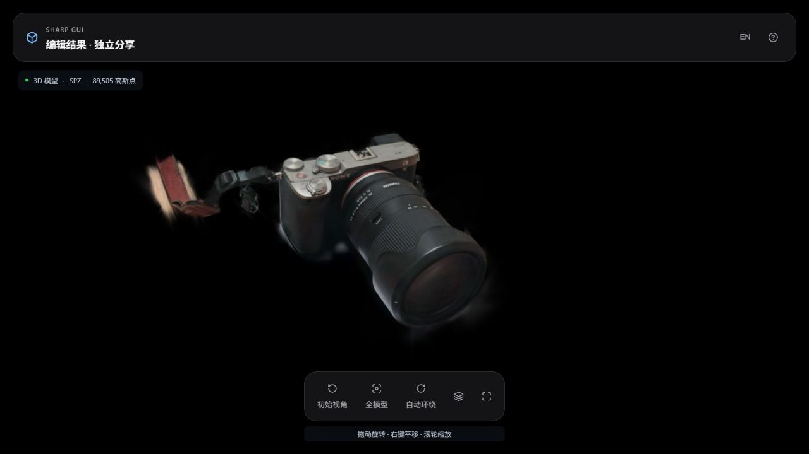

# Sharp GUI

<p align="right">
  <a href="README.md">🇨🇳 中文</a> | <a href="README.en.md">🇺🇸 English</a>
</p>
<div align="center">

**一个精美的 3D 高斯溅射 (Gaussian Splatting) 图形化界面**


<br>

**💡 项目背景**

主页：https://lueluelue12138.github.io/sharp-gui/

iOS 26 的"空间照片"带来了令人惊艳的沉浸式体验，但目前仅限于苹果生态。

作为一个 Web 技术爱好者，我开发了 Sharp GUI，旨在通过浏览器打破设备界限。在电脑上 **[一键部署](#-快速开始)** 后，即可通过局域网内 Android、Windows、Mac 或 VR 设备的浏览器，轻松生成、探索并分享你的 3D 空间记忆。这是一个探索性的开源项目，希望能为你带来乐趣。

<br>


基于 [Apple ml-sharp](https://github.com/apple/ml-sharp) 打造，无需上传云端，**本地部署，全屋访问**。除了生成和查看 3D 模型，也可以把生成结果、导入模型和本机 / 移动硬盘 / NAS 媒体整理成轻量模型资产库与照片图库。

[功能特性](#-功能特性) •
[界面预览](#-界面预览) •
[快速开始](#-快速开始) •
[3D 控制](#3d-交互控制) •
[局域网门禁](#-局域网门禁与隐私边界) •
[文档导航](#-文档导航)

</div>

> [!WARNING]
> **本地部署无内容限制** - 模型完全在本地生成，内容由用户自行负责，请遵守法律法规。详见 [免责声明](#disclaimer)。
>
> **No content restrictions for local deployment** - Users are responsible for generated content. See [Disclaimer](#disclaimer).

---

## 📑 目录

<table align="center">
<tr>
<td width="190" align="center" valign="top">

### 🚀

**开始上手**

<sub>几分钟跑起来</sub>

<br>

[近期重点更新](#-近期重点更新)<br>
[快速开始](#-快速开始)<br>
[使用指南](docs/usage.md)<br>
[版本与更新](#版本与更新)

</td>
<td width="190" align="center" valign="top">

### ✨

**功能与设计**

<sub>看看它能做什么</sub>

<br>

[功能特性](#-功能特性)<br>
[界面预览](#-界面预览)

</td>
<td width="190" align="center" valign="top">

### ⚙️

**配置与安全**

<sub>自定义与隐私边界</sub>

<br>

[配置选项](docs/deployment.md#%EF%B8%8F-配置选项)<br>
[视频重建配置](docs/deployment.md#视频重建配置)<br>
[局域网门禁](#-局域网门禁与隐私边界)

</td>
<td width="190" align="center" valign="top">

### 🛠️

**开发与社区**

<sub>动手改造、参与贡献</sub>

<br>

[技术架构](docs/development.md#%EF%B8%8F-技术架构)<br>
[开发者指南](docs/development.md)<br>
[版本历史](#-版本历史)<br>
[参与贡献](#-参与贡献) · [致谢](#-致谢)

</td>
</tr>
</table>

<div align="center"><sub>📄 <a href="#-许可证">许可证</a> &nbsp;·&nbsp; ⚠️ <a href="#disclaimer">免责声明</a></sub></div>

---

## 🆕 近期重点更新

<details open>
<summary><b>点击折叠 / Click to collapse — 用户可感知的重点能力</b></summary>

<br>

**🎥 视频重建路线重构 · 画质与效率升级**：重构抽帧、相机配准、训练和导出流程，采用固定源帧规划、COLMAP + OOOBrush，相较旧路线显著改善细节与边缘表现，并减少处理耗时。高质量保持 1920 长边，极致档在 12 GB 预算下保留 3840 长边；不以降低高质量分辨率换取速度。支持质量档、配准检查、原视频回看和 PLY / SPZ 导出；资产详情可查看实际重建耗时、阶段用时和训练信息。[同素材画质与耗时复核](docs/video-reconstruction-quality.md)记录了验证范围；实际耗时随素材、档位和设备变化。

**✂️ 模型编辑**：从资产库或查看器进入编辑器，矩形 / 球形 / 盒形选择清理高斯点，拖动边界调整选区、校准原点和朝向；支持撤销 / 重做、保存副本或覆盖原模型。支持范围见[编辑说明](docs/model-editor.md)。

**🎬 导出动画**：手动记录镜头关键帧，选择平滑曲线，通过轨迹总览检查相机路径和拍摄角度，再导出 1080p / 4K 视频。详见[动画导出说明](docs/camera-animation.md)。

**🔗 图库与模型联动**：已生成模型的原片显示蓝色 3D 标识，可直接查看对应模型、选择多个版本或设定默认结果；固定「模型原片」相册汇总关联图片和视频。详见[联动说明](docs/model-source-gallery.md)。

**📦 模型资产库**：统一展示生成模型与导入的 `.ply/.spz/.splat/.rad`，支持筛选、排序、滚动增量加载、近期模型、详情面板、批量导入、下载和删除；默认打开/下载格式会跟随 Settings 中的默认模型格式并自动回退到可用文件。

**🗂️ 本地媒体图库**：把本机、移动硬盘或 NAS 目录配置为相册，支持照片/视频混合浏览、筛选、预览、下载；照片可单张或批量转 3D，视频可直接播放、拖动进度、全屏查看。

**📤 独立 HTML 分享升级**：重建分享查看器，同步模型方向与保存的初始视角，新增全模型取景、环绕、背景切换、移动控制和双语帮助；模型与查看器嵌入单文件，可离线打开。详见[分享说明](docs/standalone-sharing.md)。

**📦 Windows 完整便携包**：提供 `cu128-rtx50`、`cu126-mainstream` 两类核心便携 ZIP，并额外提供面向 RTX 50 视频重建的 `cu128-rtx50-video-recon` 完整包（通过 GitHub Release 网盘入口下载，附 SHA256 校验）。

**⚙️ 设置分组与配置继承**：设置按常规、访问与安全、查看器、图库、视频重建、更新中心分组；配置保存到系统用户目录，同账号换新版完整包继续使用原工作区、模型和相册，也可从旧包恢复配置。详见[配置存储与恢复](docs/global-configuration.md)。

**🔐 局域网访问更安全**：可选访问码门禁、局域网绑定开关、敏感文件保护和默认关闭调试模式，适合在家庭局域网中长期运行。

完整变更见 → **[Latest Release](https://github.com/lueluelue12138/sharp-gui/releases/latest)**

</details>

---

## ✨ 功能特性

### 🏠 一次部署，全屋访问

无需在每台设备上安装 App。只需在一台电脑上运行 Sharp GUI，局域网内的手机、平板和 VR 设备均可通过浏览器直接访问，即刻享受 3D 视觉盛宴。HTTPS 为陀螺仪等功能提供所需的安全上下文，实际可用性取决于浏览器、设备和授权。

### 🚀 核心功能

| 功能                | 描述                                                                                                                                            |
| ------------------- | ----------------------------------------------------------------------------------------------------------------------------------------------- |
| **📸 空间影像生成** | 上传单张图片，基于 Apple ML-Sharp 自动生成 3D 高斯溅射模型，安装时预下载约 2.62 GiB 模型                                                        |
| **🎥 视频 3DGS 重建** | 从本地相册视频或拖入视频创建静态 Gaussian Splat 模型，使用 COLMAP + Brush，支持质量档、任务阶段、缩略图和原视频回看 |
| **🖼️ 现代工作流**   | 多选/拖拽批量上传、虚拟滚动图库、站内原图对比、智能任务队列（活跃 2s / 空闲 10s 轮询），删除滑出动画、可取消的待处理任务                          |
| **📦 模型资产库**   | 统一浏览生成与导入模型，支持 `.ply/.spz/.splat/.rad`、筛选排序、详情元数据、近期模型、批量导入和游标式滚动加载                              |
| **🗂️ 本地媒体图库** | 配置多个本地/NAS 目录作为相册，支持照片与视频混合浏览、筛选、预览、下载；照片可一键转 3D，视频可播放并发起视频重建                          |
| **👁️ 全能查看器**   | 基于 Three.js + Spark 2.0 的 WASM 加速查看器，鼠标 / 触摸 / 键盘 (WASD) / 陀螺仪全模态控制，点击模型聚焦 + GPU 聚焦光环，快捷姿态调参             |
| **✂️ 模型编辑**     | 矩形 / 球形 / 盒形选区、拖动参数与边界、清理高斯点、原点及朝向校准、撤销 / 重做、保存副本或覆盖；保留原片关联 |
| **🎬 导出动画**     | 镜头关键帧与五种运动曲线、三维轨迹和视锥预览，导出横竖屏 1080p / 4K、24 / 30 / 60 fps 无音轨 WebM / MP4 视频 |
| **🔗 原片与模型联动** | 蓝色 3D 标识、关联模型入口、多版本及默认结果选择，固定「模型原片」相册按来源汇总 |
| **🎭 Reveal Effects** | Magic / Spread / Unroll / Twister / Rain 五种模型登场动画，可随时重放                                                                          |
| **📱 移动端优化**   | 完美适配手机/平板，陀螺仪体感控制（iOS 风格指示球反馈）、虚拟摇杆、触摸手势、抽屉式侧边栏                                                        |
| **🥽 VR/AR 预览**   | WebXR VR 模式 + AR 透视模式 (Passthrough)，Quest 3/Pro 等头显沉浸式体验，手柄摇杆 + AR 触摸手势                                                   |
| **📤 零门槛分享**   | 导出嵌入模型与 Spark 2.0 查看器的独立 HTML，保留模型方向与初始视角，支持全模型取景、环绕、背景切换和移动控制，可离线打开 |
| **🎮 GPU 加速**     | 自动检测 NVIDIA GPU，智能匹配 CUDA 版本的 PyTorch（cu118 / cu126 / cu128），显著加速推理                                                          |
| **🔄 安全自更新**   | Settings 显示正式版本与精确提交，支持 Stable / Latest 检查和兼容代码一键更新；失败时自动恢复，便携包无需系统 Git                                  |
| **🔐 安全与隐私**   | 数据完全本地化、自签名 SSL 一键生成、可选局域网门禁（HttpOnly Cookie + 访问码 + 抗暴力猜测）                                                      |
| **🚀 一键部署运行** | 自动配置 Python/Git 环境、下载依赖、预下载模型、生成 HTTPS 证书、骨架屏加载进度，开箱即用                                                        |

### 🎨 Apple 风格界面

通透玻璃面板、系统字体、深浅主题、自然过渡与响应式控件，在电脑和移动设备上保持一致的操作体验。

---

## 📷 界面预览

### 主界面

<p align="center">
  
</p>

<p align="center"><i>近期模型 + 3D 空间预览区域 + 底部毛玻璃控制栏</i></p>

### 本地媒体图库

<p align="center">
  
</p>

<p align="center"><i>多目录相册、照片/视频混合浏览、媒体预览、多选一键转 3D</i></p>

### 视频 3DGS 重建

<p align="center">
  
</p>

<p align="center"><i>从相册视频或拖入视频进入重建弹窗，选择模式、质量、自定义参数和依赖状态</i></p>

<p align="center">
  
</p>

<p align="center"><i>训练过程动态录屏示意；重建参数以当前版本的发起面板为准</i></p>

### 模型编辑

<p align="center">
  
</p>

<p align="center"><i>清理多余高斯点、拖动选区边界、校准原点和朝向，保存副本或覆盖原模型</i></p>

### 导出动画与轨迹预览

<p align="center">
  
</p>

<p align="center"><i>七个镜头组成环绕、升降与远近变化的路径；蓝色为关键帧和轨迹，白色视锥随时间轴同步，辅助物不会进入导出视频</i></p>

### 移动端适配

<p align="center">
  &nbsp;&nbsp;&nbsp;&nbsp;
  
</p>

<p align="center">
  <i>左：手机端抽屉式侧边栏 | 右：平板端分栏布局</i>
</p>

### 🎬 相机移动控制

<p align="center">
  &nbsp;&nbsp;&nbsp;&nbsp;
  <a href="docs/images/demo-joystick-2.mp4"></a>
</p>

<p align="center">
  <i>WASD/QE 键盘移动与移动端虚拟摇杆；点击摇杆图示查看 MP4 演示</i>
</p>

### 🎬 批量上传 + 队列处理

<p align="center">
  
</p>

<p align="center"><i>拖拽多张图片到侧边栏，队列实时更新处理进度</i></p>

### 🎬 陀螺仪体感控制 (移动端)

<p align="center">
  
</p>

<p align="center"><i>倾斜手机控制视角，iOS 风格实时指示球反馈</i></p>

### 🎬 一键导出分享

<p align="center">
  
</p>

<p align="center"><i>导出单个 HTML，在支持 WebGL2 的浏览器离线打开，保留初始视角并支持环绕与背景切换</i></p>

---

## 🚀 快速开始

单图重建支持 Windows、macOS 和 Linux 安装，可使用 NVIDIA CUDA、Apple Silicon MPS 或 CPU；各平台验证状态见[完整安装指南](docs/deployment.md#系统要求)。视频重建当前完成端到端验证的平台为 **Windows + RTX 5070 Ti Laptop（12 GB）**。

### Windows 完整便携包

在 [GitHub Releases](https://github.com/lueluelue12138/sharp-gui/releases) 查看版本、网盘入口和 SHA256，也可直接打开[便携包网盘](https://pan.quark.cn/s/94f4acaada40)。按显卡和用途选择：

| 用途 | 包名 |
| --- | --- |
| RTX 50 系列，单图与核心功能 | `cu128-rtx50` |
| RTX 50 系列，包含视频重建环境 | `cu128-rtx50-video-recon` |
| RTX 50 以下主流 NVIDIA，单图与核心功能 | `cu126-mainstream` |

下载 ZIP 和同名 `.sha256.txt`，核对校验值后解压即可，无需运行安装脚本。启动方式见下方「启动应用」。完整便携包面向 NVIDIA GPU；无 NVIDIA 的设备可从源码安装。

### 从源码安装

仓库已包含前端构建产物，普通使用无需安装 Node.js。

```bash
git clone https://github.com/lueluelue12138/sharp-gui.git
cd sharp-gui
```

| 平台 | 首次安装 |
| --- | --- |
| Windows | `install.bat` |
| Linux / macOS | `./install.sh` |

通用 Release ZIP 也需要运行安装脚本，它与完整便携包不同。首次安装会下载依赖及约 2.62 GiB 的单图推理模型。完整步骤见[安装、配置与局域网访问](docs/deployment.md)。

<a id="视频重建环境手动搭建指南"></a>

视频重建另需 COLMAP、Brush 和 FFmpeg；请选视频完整包，或阅读[视频环境搭建指南](docs/deployment.md#视频重建环境手动搭建指南)。

### 启动应用

在解压后的便携包目录或项目根目录运行；完成安装后，日常使用直接启动即可。

| 安装方式 / 平台 | 启动命令 |
| --- | --- |
| Windows 完整便携包 | 双击 `portable-run.bat` |
| Windows 源码 / 通用 Release ZIP | `run.bat` |
| Linux / macOS | `./run.sh` |

### 访问与更新

启动后访问 **https://127.0.0.1:5050**，同一局域网的其它设备使用部署电脑的 IP。HTTPS / 陀螺仪准备见[访问说明](docs/deployment.md#启用-https-推荐)。

<a id="版本与更新"></a>

在 **设置 → 更新中心** 检查更新：**Stable** 使用正式版，**Latest** 使用较新的主分支代码、测试程度较低。支持的源码安装和受管便携包可直接安装兼容更新；旧便携包需先换新版完整包。工作区、模型和配置保留，运行环境变更可能要求下载新完整包。详见[更新与命令行方式](docs/deployment.md#版本与更新)。

---

<a id="3d-交互控制"></a>

## 🎮 3D 交互控制

### 基础操作

| 操作     | 桌面端       | 移动端   |
| -------- | ------------ | -------- |
| 旋转视角 | 鼠标左键拖拽 | 单指滑动 |
| 平移画面 | 鼠标右键拖拽 | 双指平移 |
| 缩放     | 滚轮         | 双指捏合 |
| 精细缩放 | Shift + 滚轮 | -        |
| 锁定焦点 | 点击模型     | 点击模型 |

### 相机移动

| 控制方式         | 功能描述                             |
| ---------------- | ------------------------------------ |
| **WASD / QE**    | 键盘平移相机（前后左右上下）         |
| **Shift + WASD** | 加速移动模式                         |
| **Alt + WASD**   | 精细移动模式                         |
| **虚拟摇杆**     | 移动端触摸平移（点击 Move 按钮开启） |

### 特殊模式

| 模式     | 操作                   | 说明                                                |
| -------- | ---------------------- | --------------------------------------------------- |
| 快捷控制 | 点击齿轮按钮           | 调整模型缩放、位置、旋转、交互方向和显示质量        |
| 渲染特效 | 点击右侧特效轨道       | 切换或重放 Magic / Spread / Unroll / Twister / Rain |
| 陀螺仪   | 点击「Gyro」按钮       | 倾斜手机控制视角                                    |
| 正面视角 | 点击「Front View」按钮 | 限制为正面视角，再次点击自由                        |
| 重置视角 | 点击「Reset」按钮      | 恢复初始视角                                        |
| 全屏模式 | 点击「Fullscreen」按钮 | 沉浸式预览                                          |
| VR 预览  | 点击「VR」按钮         | 进入 VR 模式（需 VR 设备/模拟器）                   |
| AR 透视  | 点击「AR」按钮         | 进入 AR 模式，现实世界叠加 3D 模型                  |
| 重置视角 | 按下「R」键            | 快捷键重置相机到初始位置                            |

---

## 🔐 局域网门禁与隐私边界

- **访问设置**：在设置第二项「访问与安全」中配置局域网访问和访问码。门禁默认关闭，开启后其它设备需先解锁。
- **管理权限**：删除模型、管理相册和修改设置仅限本机；已解锁远程设备默认只能浏览、下载和分享，远程生成需单独开启。
- **数据位置**：配置保存在系统用户目录，模型和相册仍使用所选工作区。换包前请保留原数据目录；恢复旧配置见[配置存储与恢复](docs/global-configuration.md)。
- **分享边界**：独立 HTML 包含模型数据，发送后无法通过原应用收回；不会附带原图、原视频和工作区路径。

完整权限矩阵、HTTPS、反向代理及部署注意事项见[局域网访问说明](docs/deployment.md#-局域网门禁与隐私边界)。

---

<a id="-使用指南"></a>
<a id="从视频生成-3d-模型"></a>
<a id="-配置选项"></a>
<a id="-开发者指南"></a>

## 📚 文档导航

| 文档 | 内容 |
| --- | --- |
| [使用指南](docs/usage.md) | 单图 / 视频生成、资产库、图库、编辑、动画与分享的详细步骤 |
| [安装、配置与局域网访问](docs/deployment.md) | 安装方式、更新、工作区、视频工具、HTTPS、权限与部署 |
| [开发者指南](docs/development.md) | 项目结构、技术栈、前端开发、环境变量与发布 |

专题说明：[模型编辑](docs/model-editor.md) · [导出动画](docs/camera-animation.md) · [图库与模型联动](docs/model-source-gallery.md) · [独立 HTML 分享](docs/standalone-sharing.md) · [视频画质与耗时复核](docs/video-reconstruction-quality.md)

---

## 🤝 致谢

- [Apple ML-Sharp](https://github.com/apple/ml-sharp) - 核心 3D 生成模型
- [Spark](https://github.com/nickthetimid/spark) - WASM 加速高斯溅射渲染引擎 (Spark 2.0)
- [Gaussian Splats 3D](https://github.com/mkkellogg/GaussianSplats3D) - 原版 Three.js 高斯溅射渲染器（Legacy 版本使用）
- [antimatter15/splat](https://github.com/antimatter15/splat) - Splat 格式转换参考

---

## 🙋 参与贡献

欢迎提交 Issue 和 Pull Request！

- 🐛 **Bug 反馈** - 在 [Issues](https://github.com/lueluelue12138/sharp-gui/issues) 中提交问题
- 💡 **功能建议** - 通过 Issue 讨论新功能想法
- 🔧 **代码贡献** - Fork 项目后提交 PR
- 🖥️ **平台测试** - 如果你在 NVIDIA GPU 或其他未验证环境上测试通过，欢迎反馈！

---

## 📜 版本历史

完整版本说明、功能演进、Pre-release 通道与下载入口：

- 📦 **[GitHub Releases](https://github.com/lueluelue12138/sharp-gui/releases)** — 所有历史版本与 Release Notes
- 🆕 **[最新版本 / Latest](https://github.com/lueluelue12138/sharp-gui/releases/latest)** — 当前正式发布
- 🧪 **[Pre-release 通道](https://github.com/lueluelue12138/sharp-gui/releases?q=prerelease%3Atrue)** — 抢先体验未稳定的功能

---

<a name="disclaimer"></a>

## ⚠️ 免责声明

由于本地部署**生成内容无限制**，本项目生成的 3D 模型由用户使用 AI 工具生成，**模型内容由用户自行负责**，与本开源项目及其开发者无关。

**严禁将本工具用于生成或传播任何违法、侵权或不当内容。**

---

## 📄 许可证

本项目基于 MIT 许可证开源。

便携包内置 MinGit 等第三方组件时，其来源、版本和许可位置见 [THIRD_PARTY_NOTICES.md](THIRD_PARTY_NOTICES.md)。

请注意：Sharp GUI 代码的 MIT 许可证不覆盖 ML-Sharp 模型；该模型适用 Apple 单独的 [模型许可证](https://github.com/apple/ml-sharp/blob/main/LICENSE_MODEL)，仅限非商业用途。

---

<div align="center">

**如果觉得有用，请给个 ⭐ Star 支持!**

Made with ❤️ by [lueluelue12138](https://github.com/lueluelue12138)

</div>
